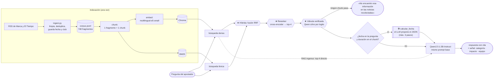

# Offside

[](https://github.com/JeanCarloLond/offside-londono-garces-ospina/actions/workflows/lint.yml)
[](LICENSE)
[](#entregables)

> **Offside responde las preguntas de un apostador recreativo sobre noticias de fútbol —«¿juega Vinicius el Clásico?»— buscando en la prensa que recolectamos, para que decida con información y no solo con el titular que alcanzó a leer en el celular.**
>
> Una respuesta es buena cuando **dice lo que dicen las noticias, cita de cuál lo saca, acierta el tipo de hecho y la dirección del impacto, no confunde un rumor con un hecho y, si no lo sabe, lo dice en vez de inventar**. Y para saber si lo consigue, lo medimos con la misma vara desde el Módulo 2.

Proyecto integrador del curso SI4006 · Tópicos Especiales y Aplicaciones en IA · Universidad EAFIT.

---

## Entregables

| Módulo | Qué es | Empiece por aquí | Artefactos |
|---|---|---|---|
| **M3** · RAG agéntico | Un RAG sobre 748 noticias reales: ingenuo, avanzado (híbrida + reranker + válvula verificada) y con una herramienta de fechas, medido con el harness de M2 y con RAGAS | **[Ir a M3 ↓](#m3--rag-que-recupera-actúa-y-se-evalúa)** · [`docs/rag-m3.md`](proyecto1/docs/rag-m3.md) | [eval set](proyecto1/eval/eval_set_m3.json) · [código](proyecto1/rag/) · [scorecard](proyecto1/rag/resultados/scorecard_m3.csv) · [RAGAS](proyecto1/rag/resultados/ragas_m3.csv) · [notebook](proyecto1/notebooks/M3_RAG_agentico.ipynb) |
| **M2** · Evaluación rigurosa | Harness de 3 dimensiones + scorecard del baseline, con la rúbrica del juez y su sesgo medido | **[Ir a M2 ↓](#m2--harness-de-evaluación)** · [`docs/harness-m2.md`](proyecto1/docs/harness-m2.md) | [eval set](proyecto1/eval/eval_set.json) · [rúbrica del juez](proyecto1/eval/judge_rubric.yaml) · [scorecard](proyecto1/eval/scorecard_baseline.csv) · [notebook](proyecto1/notebooks/M2_harness_evaluacion.ipynb) |
| **M1** · Fine-tuning con LoRA | BETO afinado sobre prensa deportiva, comparado contra tres baselines | **[Ir a M1 ↓](#m1--fine-tuning-con-lora)** · [`docs/results.md`](proyecto1/docs/results.md) | [notebook](proyecto1/notebooks/M1_finetuning_LoRA_offside.ipynb) · [dataset](proyecto1/docs/dataset.md) · [recolección](proyecto1/data_collection/) |

Los notebooks abren en Colab con un clic y clonan el repo solos:

[](https://colab.research.google.com/github/JeanCarloLond/offside-londono-garces-ospina/blob/main/proyecto1/notebooks/M3_RAG_agentico.ipynb) M3 · RAG
&nbsp;&nbsp;
[](https://colab.research.google.com/github/JeanCarloLond/offside-londono-garces-ospina/blob/main/proyecto1/notebooks/M1_finetuning_LoRA_offside.ipynb) M1 · fine-tuning
&nbsp;&nbsp;
[](https://colab.research.google.com/github/JeanCarloLond/offside-londono-garces-ospina/blob/main/proyecto1/notebooks/M2_harness_evaluacion.ipynb) M2 · harness

### Equipo

| Integrante | Correo |
|---|---|
| Jean Carlo Londoño Ocampo (contacto) | jclondonoo@eafit.edu.co |
| Alejandro Garcés Ramírez | agarcesr@eafit.edu.co |
| Nicolás Ospina Torres | nospinat@eafit.edu.co |

---

## M3 · RAG que recupera, actúa y se evalúa

Reporte completo en [`docs/rag-m3.md`](proyecto1/docs/rag-m3.md) · notebook ejecutable en
[`M3_RAG_agentico.ipynb`](proyecto1/notebooks/M3_RAG_agentico.ipynb) · código en
[`proyecto1/rag/`](proyecto1/rag/) · resultados en [`rag/resultados/`](proyecto1/rag/resultados/).

| | |
|---|---|
| Corpus | 748 fragmentos RSS reales (Marca y El Tiempo, agosto y 14 de octubre de 2026), uno por chunk. Solo titular y entradilla de sindicación, con enlace; el texto es de cada medio |
| Generador | `Qwen/Qwen2.5-1.5B-Instruct`, greedy. El mismo modelo y el mismo prompt base en todas las filas |
| Índice | `multilingual-e5-small` en Chroma, más BM25 en memoria. Sin solapamiento, top-k = 4 |
| Eval set | 27 preguntas con `input`, `esperado` y `criterio`: 4 sin respuesta en el corpus, 3 que exigen calcular fechas y 17 adversariales |
| Evaluación | `harness(eval_set, sistema)` de M2 sin cambios, con su juez (rúbrica v1); un juez v2 que sale del feedback de M2; y RAGAS |

### El pipeline



Las piezas con ★ son el RAG avanzado; 🛠 es la capa agéntica. La línea punteada es el RAG ingenuo:
búsqueda densa, top-4, generar.

### Por qué cada técnica: el diagnóstico del RAG ingenuo

Partimos de la lista de fallos del ingenuo. Dos cosas la ordenan: la recuperación casi nunca falla (con
búsqueda densa el documento correcto llega al top-4 en 22 de 23 preguntas), y el generador de 1.5B no
sabe cuándo callar (con el prompt que mejor contesta inventa en las 4 preguntas sin respuesta; con el
que calla, calla también en 12 de las 23 que sí la tienen).

| Falla del ingenuo | Ejemplo | Qué la ataca |
|---|---|---|
| El chunk llega, pero un distractor va delante | «¿Cómo está Musiala?»: delante quedan noticias de agosto que lo daban de baja | Reranker (cross-encoder) |
| Nombres propios y términos exactos | dense pone ruido primero en Celta y Ochoa; BM25 no | Búsqueda híbrida BM25 + dense (RRF) |
| Inventa cuando no está en el corpus | «¿Mbappé se pierde el Clásico?» → responde con la sanción de Vinicius | Válvula verificada: el mismo Qwen, sí/no por logits, chunk a chunk |
| Hay que calcular una fecha | «¿Puede contar el Oviedo con Chaira el 29 de noviembre?» | Herramienta `calcular_fecha` |
| El chunk no llega | el portero de la Roma: el titular es «El rapero con guantes…» | HyDE y multi-query, probadas y descartadas: empeoran la recuperación (MRR 0,90 → 0,74) |

### La herramienta: cuándo se usa y cuándo no

`calcular_fecha(fecha_inicio, cantidad, unidad, fecha_objetivo)` tiene su esquema JSON en el prompt,
parseo tolerante (`'tres'`, `"entre dos y tres meses"`, `'27 de agosto'`, comillas simples…), errores
que vuelven al modelo para que corrija y un tope de 3 pasos
([`herramientas.py`](proyecto1/rag/herramientas.py); las pruebas, en
[`test_parseo.py`](proyecto1/rag/test_parseo.py), corren en el CI). En el corpus real solo hay dos bajas
con duración numérica, así que el uso se muestra en el eval set y en una prueba aislada con noticias
ficticias ([`prueba_planificador_m3.csv`](proyecto1/rag/resultados/prueba_planificador_m3.csv)):

| Consulta | ¿Hace falta? | ¿La llama? | Lo que propone el modelo → resultado |
|---|---|---|---|
| «¿Puede contar el Oviedo con Chaira para el 29 de noviembre?» (eval, M3-23) | sí | sí | `cantidad: "entre dos y tres meses"`, que se parsea como 3 → «el 29-11 es 21 días DESPUÉS del fin del plazo (8-11)» |
| «¿Cuenta el Atlético Ribera con Ferro para el 1 de septiembre?» (ficticia) | sí | sí | 2 meses desde el 15-08 → «44 días ANTES del fin del plazo: todavía de baja» |
| «¿Puede jugar Medrano el 25 de septiembre?» (ficticia) | sí | sí | 10 días desde el 20-09 → «5 días ANTES del fin del plazo» |
| «¿Estará Quintana disponible el 15 de marzo?» (ficticia) | sí | sí, con error | propone 2026-03-15, anterior a la noticia; la herramienta lo rechaza, el modelo repite el error y el tope corta a los 3 pasos |
| «¿Volverá Uche a jugar con el Getafe esta temporada?» (eval, M3-09) | no: la noticia ya dice «toda la temporada» | no | — |
| «¿Qué lesión tiene Lunar?» (ficticia) | no | no | — |

En todo el eval set la herramienta no se llamó ni una vez sin hacer falta (24 preguntas). Cuándo
llamarla lo decide una regla (fecha en la pregunta y duración con número en un chunk), no el LLM:
cuando lo decidía el LLM, la llamó 0 de 4 veces. El detalle está en
[`docs/rag-m3.md`](proyecto1/docs/rag-m3.md#8--la-capa-agéntica).

### La tabla evolutiva

Mismo eval set (27 preguntas), mismo harness, mismo generador y mismo prompt base. La latencia es la
mediana por consulta, de punta a punta, en una GTX 1650 Ti de 4 GB; en una T4 es menor, lo que cuenta
es la comparación entre filas. D2 es el juez de M2 tal cual; D2·v2 es el juez revisado tras el
feedback (ver más abajo).

| Sistema | D1 · F1 macro | D2 · juez v1 | D2·v2 | D3 · tasa accionable | Latencia mediana | Calla sin respuesta | Calla teniendo respuesta |
|---|---:|---:|---:|---:|---:|---:|---:|
| Línea base M2 · LoRA de M1 (sin RAG) | 0,060 | 2,52 | 2,59 | 0,15 | < 0,1 s | — | — |
| Línea base M2 · léxico (sin RAG) | 0,110 | 2,52 | 3,37 | 0,19 | < 0,1 s | — | — |
| Mismo LLM, sin recuperación | 0,026 | 2,59 | 2,70 | 0,11 | 9,3 s | 3/4 | 19/23 |
| RAG ingenuo (sesión 7) | 0,139 | 2,59 | 3,96 | 0,37 | 15,1 s | 0/4 | 0/23 |
| RAG avanzado (híbrida + reranker + válvula verificada) | 0,289 | 2,93 | 3,93 | 0,52 | 22,1 s | 3/4 | 4/23 |
| Sistema final (+ herramienta) | 0,289 | 2,93 | 3,93 | 0,52 | 22,2 s | 3/4 | 4/23 |

Las líneas base de M2 son clasificadores de fragmentos: aquí reciben la pregunta como si fuera una
noticia y no tienen acceso al corpus.

Ablación, una técnica a la vez ([`scorecard_m3.csv`](proyecto1/rag/resultados/scorecard_m3.csv)):

| Sistema | D1 | D2 · juez v1 | D3 | Latencia | Calla sin respuesta | Calla teniendo respuesta |
|---|---:|---:|---:|---:|---:|---:|
| RAG ingenuo | 0,139 | 2,59 | 0,37 | 15,1 s | 0/4 | 0/23 |
| + solo híbrida | 0,266 | 2,67 | 0,41 | 15,5 s | 0/4 | 0/23 |
| + solo reranker | 0,255 | 2,70 | 0,52 | 16,3 s | 1/4 | 0/23 |
| + solo válvula verificada | 0,266 | 2,89 | 0,48 | 21,6 s | 3/4 | 3/23 |
| + solo HyDE (descartada) | 0,185 | 2,48 | 0,33 | 26,1 s | 0/4 | 0/23 |
| Avanzado sin híbrida | 0,294 | 2,93 | 0,52 | 22,6 s | 3/4 | 4/23 |
| Avanzado sin reranker | 0,226 | 2,93 | 0,48 | 18,7 s | 3/4 | 3/23 |
| Avanzado sin válvula verificada | 0,194 | 2,63 | 0,48 | 13,5 s | 0/4 | 0/23 |
| Avanzado completo | 0,289 | 2,93 | 0,52 | 22,1 s | 3/4 | 4/23 |

### RAGAS

Las cuatro métricas están implementadas en [`ragas_local.py`](proyecto1/rag/ragas_local.py) con las
definiciones de RAGAS, y el juez es `Qwen/Qwen2.5-1.5B-Instruct` leyendo logits de sí/no. No usamos la
librería `ragas` (no la probamos): le pide al juez salidas JSON en cada paso, y nuestro 1.5B, como
generador, devolvía JSON incompletos con frecuencia. Leyendo logits, cada veredicto es una pasada
determinista sin texto que parsear.

Se calcula sobre las 23 preguntas con respuesta en el corpus. Cada caso lleva la pregunta, la
respuesta, los chunks que vio el generador y la referencia escrita a mano. La faithfulness se calcula
sobre las respuestas que no son la válvula (`n`), porque «no encuentro esa información» no tiene
afirmaciones que verificar. `context precision (ids)` es la misma métrica calculada con los documentos
relevantes anotados a mano, y sirve para auditar al juez. Siguiendo la sesión 10, la calculamos también
para cada técnica sola: el reranker debería mover la precision y la híbrida el recall.

| Sistema | Faithfulness | Answer relevancy | Context precision | Context recall | Context precision (ids) |
|---|---:|---:|---:|---:|---:|
| RAG ingenuo | 0,80 (n=23) | 0,86 | 0,83 | 0,88 | 0,87 |
| + solo híbrida | 0,85 (n=23) | 0,86 | 0,86 | 0,89 | 0,91 |
| + solo reranker | 0,89 (n=23) | 0,86 | 0,84 | 0,88 | 0,95 |
| + solo válvula verificada | 0,85 (n=20) | 0,74 | 0,82 | 0,74 | 0,79 |
| RAG avanzado | 0,88 (n=19) | 0,71 | 0,83 | 0,74 | 0,83 |
| Sistema final | 0,88 (n=19) | 0,71 | 0,83 | 0,75 | 0,83 |

**Sanity check del juez RAGAS** (8 afirmaciones de verdad conocida sobre clubes ficticios): **8/8**.

### El juez, revisado tras el feedback de M2

El feedback de M2 señaló tres cosas: el juez casi no separaba respuestas buenas de malas; el
`criterio` que recibe casi le dice la etiqueta correcta, así que es un juez con referencia; y
`render_senal()` solo neutraliza la verbosidad mientras todo son etiquetas, pero el RAG escribe texto.
Lo atendimos así, sin tocar la columna D2, que sigue siendo el juez de M2 para poder comparar con esa
entrega:

1. Un juez v2 ([`judge_razonado.py`](proyecto1/eval/judge_razonado.py),
   [`judge_rubric_v2.yaml`](proyecto1/eval/judge_rubric_v2.yaml)) que puede escribir un análisis antes
   de que se lean los logits del puntaje, y que ve la respuesta en texto además de la señal.
2. El sanity check de M2 repetido dos veces: con el criterio completo y con un criterio «ciego» que
   describe qué mirar pero no nombra la categoría ni el impacto. Si el juez solo acierta con el
   completo, depende de la etiqueta que le damos.
3. Una plantilla nueva, `render_senal_y_texto()` en el harness, que añade la prosa recortada a 240
   caracteres, y una prueba de verbosidad con texto
   ([`evaluar_juez_v2.py`](proyecto1/rag/evaluar_juez_v2.py)).

Sanity check ([`sanity_juez_v2.json`](proyecto1/eval/sanity_juez_v2.json)), cinco señales de calidad
conocida sobre el mismo caso. Esperado: 5, 4, 3, 3, 1.

| Juez | Criterio completo | Criterio ciego | Signo invertido (esperado 1) |
|---|---|---|---|
| v1 de M2: Qwen2.5-1.5B, sin razonar | 4/5 en esta corrida (3/5 en M2, en CPU) | — | 3: no lo ve |
| v2 · 1.5B razonando | 1/5 | 1/5 | 2 con el completo; con el ciego pone 1 a todo |
| v2 · 1.5B sin razonar | 2/5 | 2/5 | 1, pero pone 1 a todo lo que no es perfecto |
| v2 · 3B razonando | 2/5 | 1/5 | 1 con el completo; 4 con el ciego |
| v2 · 3B sin razonar | 2/5 | 0/5 | 1 con el completo; 4 con el ciego |

En exactitud el que más acierta sigue siendo el v1. Razonar no mejoró al 1.5B: en sus análisis llega
a citar un «texto» que la señal no trae. Con el
criterio completo todas las variantes v2 ven el signo invertido, que la v1 no veía. Con el criterio
ciego ninguna lo ve. El profesor tenía razón: lo que detecta la inversión es la etiqueta que le damos
en el criterio, no el juez.

Aplicamos a las seis filas principales el 3B razonando (cuantizado a 4 bits para que quepa en 4 GB),
que es lo que se sugirió y la única variante que gradúa en vez de dar 5 o 1 (columna D2·v2,
[`scorecard_m3_juez_v2.csv`](proyecto1/rag/resultados/scorecard_m3_juez_v2.csv)):

- Separa mucho más que la v1: 4,37 cuando la categoría es correcta frente a 3,03 cuando no (delta
  +1,34; la v1, +0,80), y solo en 1 de 27 preguntas le da la misma nota a una respuesta correcta y a
  una incorrecta (la v1, en 3).
- Pero al ver la prosa se deja llevar por lo que suena bien. Al ingenuo le pone un 5 cuando presenta el
  rumor de Erik Lira como baja confirmada, que es el error más caro de la rúbrica, y otro 5 cuando
  responde el Balón de Oro de memoria. Y castiga más la válvula (1 o 2) que la v1 (3). Por eso deja al
  ingenuo (3,96) a la par del avanzado (3,93), cuando todo lo demás dice que el avanzado es mejor.
- Es inestable con las señales vacías. La rúbrica dice que no emitir señal vale 3 siempre; en las 21
  preguntas con respuesta en las que el léxico no da señal, el v2 le pone desde 1 hasta 5 (media 3,38).
  De ahí sale el 3,37 del léxico, por encima del LLM sin recuperación.
- Verbosidad: con el recorte de 240 caracteres, añadir una frase de relleno no cambia la media (4,10
  en los dos casos), pero sí la nota de 11 de las 20 respuestas, en las dos direcciones. Sin recorte,
  la media sube a 4,35. El recorte quita el sesgo en promedio, no el ruido caso a caso
  ([`sesgo_verbosidad_texto_m3.csv`](proyecto1/rag/resultados/sesgo_verbosidad_texto_m3.csv)).

Conclusión: el juez v2 separa mejor, pero premia la prosa plausible y castiga callar, que es lo
contrario de lo que pide la rúbrica. No lo adoptamos para tomar decisiones. Lo reportamos como
columna, y las conclusiones de este módulo se apoyan en la D1, la D3 y RAGAS. La dimensión 3 sigue
siendo la que cuenta el signo invertido y el rumor presentado como hecho.

### La lectura: qué movió qué, cuánto costó, qué falla queda

Antes de leer decimales: son 27 preguntas, así que un acierto vale 0,037 de accuracy, y en el F1 macro
una sola pregunta puede valer una clase entera (Erik Lira es el único caso de rumor). Un generador de
1.5B además cambia de respuesta cuando cambia el orden de los distractores. Por eso lo que sigue se
apoya en los casos y no solo en las medias. Y una categoría correcta no garantiza una respuesta
correcta: el harness mide la señal y RAGAS mide la prosa.

**1. ¿Qué movió qué?**

- Recuperar es lo que más mueve, y el avanzado mejora al ingenuo en las tres dimensiones del harness:
  F1 de 0,139 a 0,289, juez v1 de 2,59 a 2,93 y tasa accionable de 0,37 a 0,52. Sin noticias, el
  mismo LLM calla en 19 de las 23 preguntas que tienen respuesta. Las líneas base de M2 reciben la
  pregunta como si fuera una noticia y no saben nada de lo que pasó esta semana.
- El reranker es la técnica que más sube la tasa accionable por sí sola (0,37 → 0,52), y quitarlo del
  avanzado baja el F1 a 0,226 y la tasa a 0,48. En RAGAS mueve lo que la sesión 10 dice que debe
  mover: la context precision calculada con los documentos anotados pasa de 0,87 a 0,95, y la
  faithfulness de 0,80 a 0,89 porque llegan menos distractores. Gana la categoría en Musiala (pone
  delante la noticia de octubre), Ochoa, Svilar y Balón de Oro. Dos de esos aciertos lo son solo de
  categoría: en Musiala responde con otra noticia del Bayern y en Svilar el documento no llega.
- La búsqueda híbrida sola sube el F1 de 0,139 a 0,266, pero casi todo viene de una pregunta, Erik
  Lira, el único rumor, que vale una clase entera del F1 macro (además gana Mbappé y pierde
  Bentancur). En RAGAS sube algo la precision (0,83 → 0,86) y apenas el recall (0,88 → 0,89, una
  afirmación). Dentro del avanzado, quitarla no cambia nada (0,294 sin ella frente a 0,289; D2 y D3
  iguales). Su efecto en este eval set está dentro del ruido. La mantenemos porque es la segunda
  técnica de la lista y cuesta milisegundos.
- La válvula verificada es la pieza que más pesa en el avanzado. Quitarla baja el F1 de 0,289 a 0,194
  y el juez v1 de 2,93 a 2,63, y deja la válvula en 0 de 4. A cambio calla en 4 de las 23 preguntas
  que sí tenían respuesta (punto 3), y por eso el context recall del avanzado baja a 0,74.
- HyDE empeora todo (F1 0,185, juez v1 2,48) y cuesta 11 s más. La descartamos.
- El agente no mejora el harness: las tres dimensiones del avanzado y del final son iguales. La
  herramienta calcula bien el regreso de Chaira y RAGAS lo registra (el context recall de esa pregunta
  pasa de 0,75 a 1,0), pero el generador ignora el resultado y repite «entre dos y tres meses». Las
  otras dos preguntas que la necesitaban (las de Ochoa) no llegan a la herramienta porque la válvula
  las corta antes. La mantenemos porque solo se dispara cuando hace falta (0 llamadas innecesarias en
  24 preguntas), el cálculo queda registrado y es lo que mostrará la interfaz del M4. Si la
  quitáramos, el harness no cambiaría.

**2. ¿Cuánto costó?**

| Paso | Latencia mediana | Qué cuesta |
|---|---:|---|
| RAG ingenuo | 15,1 s | casi todo es generar el JSON con un 1.5B en una GPU de 4 GB |
| + reranker | +1,2 s | 20 pares por el cross-encoder, en CPU |
| + híbrida | +0,3 s | BM25 tarda milisegundos; el resto es variación de la generación |
| + válvula verificada | +6,5 s | 4 pasadas del modelo, una por chunk. Cuando calla, la consulta termina en 9,1 s sin generar |
| + herramienta | +0,2 s de mediana | solo se dispara en 1 de 27 consultas, pero esa pasa de 22 s a 36 s |
| HyDE (descartada) | +11,0 s | una generación más antes de buscar |

El avanzado tarda un 46 % más que el ingenuo (22,1 s frente a 15,1 s), casi todo por la válvula. Para
nuestro usuario creemos que compensa: el apostador consulta antes del partido, no en directo, y lo que
se paga con esa latencia es no recibir una baja inventada. HyDE no compensa. Para la versión eficiente
del M5 hay margen: las cuatro verificaciones caben en una sola pasada y el JSON de salida puede ser más
corto.

**3. ¿Qué falla queda y de qué tipo?** Cruzamos el harness con RAGAS pregunta por pregunta en las 23
con respuesta del sistema final ([`ragas_m3_por_caso.csv`](proyecto1/rag/resultados/ragas_m3_por_caso.csv)):

| Tipo | Casos | Qué se ve en RAGAS |
|---|---:|---|
| Categoría correcta | 9 | De esas, el impacto solo es correcto en 2: el modelo pone «negativo_bajo» a casi todo. La dimensión 3 no castiga quedarse corto; el juez v1 sí (nivel 4) |
| Generación: etiqueta equivocada con el contexto correcto | 8 | context recall y faithfulness altos, la categoría mal: Vinicius en la Roma (alineación → «regreso»), Isaac Romero y Ángel Pérez (sanción → «baja»), Nico Williams (baja → «duda»), Laporte y Beitia (duda → «baja»), Arrasate (su «vuelta» leída como regreso) y Chaira (ignora la herramienta) |
| La válvula calla de más | 4 | sin contexto: Erik Lira (el verificador confunde «la respuesta es que no» con «no es la fuente»), los dos de Ochoa (el resumen RSS cruzado Málaga/Girona) y Svilar (el documento no llegó) |
| Generación: inventa en la prosa | 1 | Sadiq: «ha vuelto a estar bien» cuando la noticia dice que espera pruebas (faithfulness 0,33) |
| Error del juez de RAGAS | 1 | Celta: la respuesta es correcta y el juez no la reconoce (context recall 0) |

Hay además un error de prosa que no detectan ni el harness ni RAGAS: en Nico Williams la respuesta
mezcla su baja con la indisposición de Laporte.

La falla que queda es de generación, no de recuperación. El recuperador trae el documento correcto al
top-4 en 22 de 23 preguntas; después de la válvula le llega contexto al generador en 19, y la
faithfulness de lo que responde es 0,88. Aun así etiqueta mal 8. Etiquetar es lo que hace el
clasificador de M1, así que el siguiente paso natural es separar las dos tareas: el RAG recupera y
redacta, y un clasificador afinado etiqueta el chunk recuperado. El context recall baja del ingenuo
(0,88) al final (0,75). De esos 3 puntos sobre 23, 2 vienen de la válvula (Erik Lira y los dos de Ochoa
se quedan sin contexto) y 1 del juez en Celta y de un filtrado parcial en Vinicius-Roma.

**4. ¿Qué pasó con las preguntas sin respuesta en el corpus?** El RAG ingenuo inventó en las cuatro: a
«¿Mbappé se pierde el Clásico?» respondió con la sanción de Vinicius, dijo que Lamine «estuvo hasta
hace poco lesionado», respondió el Balón de Oro de memoria («el inglés fue el último…») y al
Betis-Oporto le atribuyó «un impacto positivo». El sistema final activa la válvula en 3 de 4 (Mbappé,
cuota y Balón de Oro). Falla en Lamine Yamal: el verificador deja pasar «Pues el día que Lamine esté
fino» (P = 0,999) y el generador inventa «Lamine está cerca de estar disponible». El LLM sin
recuperación también calla en 3 de 4, pero porque calla en casi todo (19 de 23 con respuesta).

**Qué aprendimos.** Con un generador de 1.5B no encontramos un prompt que supiera a la vez responder y
callar, y el modelo tampoco supo decidir cuándo usar la herramienta (0 de 4). Las dos decisiones las
sacamos del generador: la primera la toma un clasificador sí/no por logits y la segunda una regla. El
problema del feed (resúmenes cruzados entre noticias) que vimos al construir el corpus terminó
costando dos preguntas del eval set.

**Un error nuestro.** La primera corrida completa usó por descuido la versión v4 del prompt base en
lugar de la v3 que habíamos elegido con el dev set. Lo detectamos en una revisión antes de entregar y
repetimos todo con v3. Las conclusiones de fondo no cambiaron, pero las cifras sí: con v4 el avanzado
parecía peor que el ingenuo en F1. Los números de este README son los de v3.

### Uso de IA

Usamos **Claude** (Anthropic), a través de Claude Code, como asistente durante el desarrollo de este
módulo. Para qué:

- **Código:** buena parte de [`proyecto1/rag/`](proyecto1/rag/), el juez v2, el constructor del eval
  set y el notebook de M3 se escribieron con su ayuda.
- **Depuración:** encontrar por qué fallaban el agente (no llamaba a la herramienta), la válvula y el
  parseo del JSON del modelo, y corregirlo.
- **Análisis:** correr los diagnósticos, el ajuste del prompt sobre el dev set, las ablaciones y RAGAS,
  y preparar una primera lectura de los resultados.
- **Decisiones de diseño y de entrenamiento:** discutir opciones (qué técnicas probar, cómo ajustar el
  prompt sin tocar el eval set, cómo construir la válvula y la herramienta, qué juez usar).
- **Redacción:** primeras versiones de este reporte y de [`docs/rag-m3.md`](proyecto1/docs/rag-m3.md).

**Lo que hicimos y revisamos nosotros:**

- La dirección del trabajo: qué se probaba en cada paso y en qué orden.
- El criterio para aceptar o descartar cada técnica, y las decisiones finales sobre qué se entrega y
  cómo se reporta.
- La revisión de los resultados contra los archivos de `rag/resultados/`. Cuando una corrida salió mal
  (la del prompt v4), se repitió entera y se dejó constancia en el reporte.
- Aplicar el feedback del profesor sobre el M2: pedimos rehacer el juez (que razonara antes de puntuar,
  que viera el texto y que se midiera cuánto depende del criterio), y decidimos conservar el juez v1
  como columna para comparar con el M2.
- Pedir y revisar una pasada sobre los textos para quitar redacción genérica.

Los modelos que forman parte del sistema (Qwen2.5 como generador y juez, e5-small, el cross-encoder)
no cuentan aquí: esto es sobre cómo construimos la entrega.

---

## M2 · Harness de evaluación

Ningún benchmark público mide nuestro dominio, y los que existen se contaminan. Construimos el
nuestro: un harness de **tres dimensiones** sobre 21 ejemplos curados a mano (13 adversariales), que
produce un scorecard del baseline y se puede volver a correr sobre cualquier sistema futuro — el RAG
de M3 entra sin tocar el harness.

| Dimensión | Qué mide | Qué **no** ve |
|---|---|---|
| **1 · Métrica clásica** | F1 macro sobre la categoría. Automática y reproducible | La **gravedad**: confundir una baja con una sanción cuesta lo mismo que invertir el signo |
| **2 · LLM-as-a-judge** | Si la señal le sirve al usuario, pesando el daño de cada error | Es un 1.5B falible. Su punto ciego está medido |
| **3 · Dominio** | Verificaciones duras y deterministas de los errores que no nos podemos permitir | Matices: es una puerta de sí/no |

```bash
cd proyecto1/eval
python harness.py --sin-juez    # dimensiones 1 y 3, instantáneo y sin GPU
python harness.py               # las tres
```

### La rúbrica del juez (versión 1)

El juez es `Qwen/Qwen2.5-1.5B-Instruct` y puntúa de 1 a 5 con estas anclas. Está versionada en
[`proyecto1/eval/judge_rubric.yaml`](proyecto1/eval/judge_rubric.yaml): cambiar un ancla cambia el
veredicto, así que el scorecard solo es comparable entre corridas con la misma versión.

| Nivel | Nombre | Qué respuesta lo merece |
|---:|---|---|
| **5** | Señal correcta y accionable | Acierta hecho, dirección del impacto, intensidad y equipo. El usuario puede actuar tal cual |
| **4** | Correcta con un matiz menor | Hecho y **dirección** correctos; falla la intensidad o el equipo |
| **3** | No engaña, pero tampoco sirve | No emite señal habiendo una, **o** acierta el signo con una categoría vecina. Deja al usuario como estaba |
| **2** | Señal engañosa | Inventa señal donde no la hay, o infla el impacto a alto. Añade daño |
| **1** | Señal dañina | **Invierte el signo**, o presenta un rumor como hecho confirmado |

El orden no es «cuánto acierta» sino **cuánto daño hace al decidir**: por eso *no emitir señal* (3)
puntúa por encima de *emitir una falsa* (2).

### El scorecard del baseline

| Sistema | D1 · F1 macro | D2 · juez (media) | D3 · tasa accionable |
|---|---:|---:|---:|
| Clase mayoritaria | 0,0400 | 2,52 | 0,19 |
| **Léxico/regex** | **0,4238** | 2,57 | **0,52** |
| LoRA afinado (M1) | 0,3208 | 2,52 | 0,33 |

| Sistema | Señal falsa de alto impacto | Signo invertido | Adversariales | Normales |
|---|---:|---:|---:|---:|
| Clase mayoritaria | 0 | 0 | 0,23 | 0,12 |
| Léxico/regex | **2** | **1** | 0,62 | 0,38 |
| LoRA afinado | 1 | 0 | 0,38 | 0,25 |

Datos completos en [`scorecard_baseline.csv`](proyecto1/eval/scorecard_baseline.csv) y, por ejemplo,
en [`scorecard_baseline.json`](proyecto1/eval/scorecard_baseline.json).

### La lectura, sin maquillar

**El léxico gana en la métrica clásica** (0,42 contra 0,32) y lo decimos. Pero consigue esa ventaja
**gritando**: emite dos señales falsas de alto impacto y una inversión de signo, los dos errores que
más le cuestan al usuario. El modelo afinado acierta menos pero **falla más barato**. Con una sola
métrica esa diferencia es invisible — ese es el argumento de por qué hay tres dimensiones.

**La dimensión 3 es la más severa** (0,52 en el mejor sistema) porque es la única con verificaciones
binarias: una inversión de signo tumba el ejemplo entero, sin nota parcial.

**En los adversariales el léxico va mejor (0,62) que en los normales (0,38)**, que suena al revés. La
explicación es incómoda: varias de las trampas son las que estudiamos en M1 y que nos llevaron a
parchear el léxico, mientras el bucket normal está lleno de bajas de temporada que nunca miramos. El
baseline está **sobreajustado a las trampas conocidas y ciego a los casos corrientes**.

**Y el hallazgo que más nos costó aceptar: nuestro juez discrimina poco.** Las medias de los tres
sistemas son 2,52 / 2,57 / 2,52. Medido con rigor: da 2,83 cuando la categoría es correcta y 2,38
cuando no (delta +0,45), y **en 9 de 21 ejemplos le pone la misma nota a una respuesta correcta y a
una incorrecta**. Un modelo de 1.5B en un solo forward pass no ejecuta la comparación que pide la
rúbrica. En M3 probamos dejarlo razonar antes de puntuar (ver «El juez, revisado» en la sección M3).

> **Hoy ningún sistema sirve para el usuario, y ahora sabemos exactamente por qué.** Lo que sí
> tenemos es la vara fija: el mismo scorecard medirá el RAG de M3 sin cambiar una línea del harness.

### El sesgo del juez, reconocido y mitigado

**Sesgo: verbosidad** — los jueces LLM premian las respuestas largas aunque no aporten información.
Nos afecta de lleno de cara a M3, donde el RAG redactará señales más largas que el clasificador de
M1: si el juez premia la longitud, el RAG «ganaría» sin ser mejor.

**Detección** ([`bias_check.py`](proyecto1/eval/bias_check.py)): las mismas predicciones, renderizadas
con tres longitudes y exactamente la misma información.

| Condición | Longitud media | Nota media |
|---|---:|---:|
| `escueta` | 24 chars | 2,62 |
| `fija` (la que usamos) | 55 chars | 2,57 |
| `verbosa` | 352 chars | **3,05** |

**+0,43 puntos de rúbrica** solo por escribir más largo, y 7 de 21 ejemplos cambian de nivel.

**Mitigación:** `render_senal()` emite **todas** las señales con la misma plantilla de longitud fija,
sea cual sea el sistema. La longitud deja de ser una variable y el juez no tiene de dónde sacar la
preferencia. Es estructural, no un ajuste sobre el puntaje — no eliminamos el sesgo del modelo (eso no
se puede desde fuera), le quitamos la señal de la que se alimenta.

Detalle completo en [`proyecto1/docs/harness-m2.md`](proyecto1/docs/harness-m2.md).

---

## M1 · Fine-tuning con LoRA

**Encoder — `dccuchile/bert-base-spanish-wwm-cased` (BETO)**, afinado con LoRA para clasificar
fragmentos de prensa por categoría del hecho. Antes de fijar el modelo medimos la **fertilidad del
tokenizador** sobre 40 términos del dominio: BETO parte nuestro vocabulario en **2,24** tokens por
término, contra 2,88 del DistilBERT multilingüe y 3,48 del inglés.

| Sistema | F1 macro (validación de M1) |
|---|---:|
| Clase mayoritaria | 0,1033 |
| BETO zero-shot (sin afinar) | 0,0104 |
| **LoRA afinado** | **0,2468** |

LoRA mueve el **0,27 %** de los parámetros (301 064 de 110 M), con `r=8`, `alpha=16` y
`target_modules=[query, value]`.

Tras el M2 ampliamos el corpus con la liga ya en marcha —de **251 a 497** fragmentos, incorporando
prensa colombiana— y el F1 en validación del modelo reentrenado subió a **0,7046**. El detalle y la
lectura honesta están en [`docs/results.md`](proyecto1/docs/results.md), y el dataset con sus sesgos
en [`docs/dataset.md`](proyecto1/docs/dataset.md).

---

## El repositorio

```text
.
├── proyecto1/
│   ├── notebooks/            # Los entregables de M1, M2 y M3, ejecutables en Colab
│   ├── rag/                  # M3: indexación, sistemas RAG, herramienta, RAGAS y resultados/
│   ├── eval/                 # M2: harness, juez y eval sets (el de M3 incluido)
│   ├── data_collection/      # Recolección RSS + limpieza + supervisión débil
│   ├── data/                 # processed/, gold/ y rag/ se versionan; raw/ no (ver .gitignore)
│   └── docs/                 # Dataset, resultados de M1, harness de M2 y reporte de M3
├── scripts/check_secrets.py  # Bloquea credenciales antes de que entren al repo
├── .github/workflows/        # Lint en GitHub Actions
├── .gitlab-ci.yml            # El mismo lint en GitLab
└── .pre-commit-config.yaml   # Los mismos checks, en local antes de commitear
```

### Buenas prácticas

- **Lint automático en cada push**: búsqueda de credenciales, `ruff` (Python y notebooks) y
  `pymarkdown`, en un job sin GPU. El repo vive en GitLab (trabajo diario) y en GitHub (entrega
  pública), así que los mismos checks están definidos en los dos.
- **Hooks locales opcionales**, idénticos al CI:

  ```bash
  pip install -r requirements-dev.txt
  pre-commit install
  ```

- **Nada de datos crudos ni pesos en git**: `.gitignore` excluye `proyecto1/data/raw/` y los
  checkpoints. El porqué está en [`docs/dataset.md`](proyecto1/docs/dataset.md#idioma-y-licencia): no
  redistribuimos texto periodístico, solo fragmentos de sindicación con su enlace de vuelta.
- **Licencia separada para código y datos**: el código es MIT; el texto de prensa sigue siendo de
  cada medio, y así está dicho en [`LICENSE`](LICENSE).
- **Ramas cortas y revisión**: `feature/...` o `fix/...`, con revisión de otro integrante antes de
  mergear a `main`.
