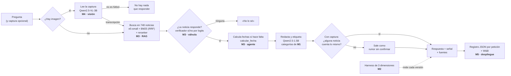

# Offside · Reporte final

Proyecto integrador de SI4006 (Universidad EAFIT), equipo Offside: Jean Carlo Londoño Ocampo,
Alejandro Garcés Ramírez y Nicolás Ospina Torres.

**Demo:** <https://huggingface.co/spaces/Jclo/offside> · **W&B:** <https://forge.coreweave.com/wandb/jeanlondo12-universidad-eafit/offside> ·
**Presentación:** [`presentacion/offside.html`](presentacion/offside.html)

## 1. El problema y el usuario

El usuario es un **apostador recreativo** que sigue el fútbol español y colombiano. Antes de un
partido tiene una pregunta concreta: ¿juega tal jugador?, ¿está sancionado?, ¿ya volvió de la
lesión? Hoy la responde con el titular que alcanza a leer en el celular, o con una captura que le
reenvían por WhatsApp, sin saber si es cierta ni si ya está superada por una noticia más reciente.

**La decisión que le ayuda a tomar** es si una noticia cambia sus expectativas sobre el partido: si
un jugador importante falta, si la baja es segura o un rumor, y hacia qué lado mueve eso al equipo.
Offside informa; no recomienda apostar.

**La métrica de éxito que importa para esa decisión** no es el F1. Es la **tasa de señal
accionable** (dimensión 3 del harness): la fracción de preguntas en las que la respuesta acierta el
tipo de hecho, no invierte la dirección del impacto, no presenta un rumor como un hecho y no inventa
una señal fuerte. Y, junto a ella, la **válvula**: cuántas veces el sistema dice "no lo sé" cuando la
respuesta no está en las noticias. Para este usuario, una baja inventada es peor que un silencio.

## 2. El sistema en un diagrama



Las piezas por módulo:

| Módulo | Pieza | Dónde está |
|---|---|---|
| M1 | Las 8 categorías y 5 niveles de impacto de la señal, y el clasificador LoRA (hoy línea base) | [`proyecto1/train/`](../proyecto1/train/) |
| M2 | El harness (F1 macro, juez v1, tasa accionable) y el eval set de dominio | [`proyecto1/eval/`](../proyecto1/eval/) |
| M3 | Recuperación híbrida, reranker, válvula verificada y herramienta de fechas | [`proyecto1/rag/`](../proyecto1/rag/) |
| M4 | El componente visual: lee la captura y la contrasta con el corpus | [`vision/`](vision/) |
| M5 | Cuantización medida, despliegue, health check, registros y W&B | [`eficiencia/`](eficiencia/), [`despliegue/`](despliegue/) |

## 3. Decisiones técnicas

| Decisión | Qué elegimos | Qué descartamos y por qué | Detalle |
|---|---|---|---|
| Modelo base del clasificador (M1) | BETO afinado con LoRA | DistilBERT multilingüe e inglés: parten más nuestro vocabulario (2,88 y 3,48 tokens por término frente a 2,24) | [`docs/results.md`](../proyecto1/docs/results.md) |
| Generador del RAG (M3) | Qwen2.5-1.5B-Instruct | Modelos de 3B o más no caben junto al resto en una GPU de 4 GB ni en Colab gratis con holgura | [`docs/rag-m3.md`](../proyecto1/docs/rag-m3.md) |
| Recuperación (M3) | e5-small + BM25 (RRF) + reranker + válvula verificada | HyDE y multi-query: empeoraban la recuperación (MRR 0,90 → 0,74). Un umbral del reranker como válvula: no separaba las preguntas con y sin respuesta | [`docs/rag-m3.md`](../proyecto1/docs/rag-m3.md) |
| Patrón visual (M4) | Visión como entrada: Qwen2.5-VL-3B transcribe la captura y el RAG la contrasta con el corpus | Visión como salida (generar imágenes): una imagen generada no es evidencia para una apuesta. CLIP como herramienta: clasifica imágenes, pero aquí hace falta leer texto | sección 5 |
| Qué texto de la captura usa el sistema | Solo la transcripción literal | La paráfrasis ("Hecho: ...") que añade el modelo de visión: es texto generado y en la captura falsa le inventó el club a Mbappé | sección 9 |
| Técnica de eficiencia (M5) | Cuantizar el generador, que es lo que más tarda y más memoria ocupa | Destilar: no hay tiempo ni datos para entrenar un alumno. LoRA sobre un modelo más chico: el 1.5B ya es pequeño | sección 4 |
| Dónde desplegar (M5) | Hugging Face Spaces con ZeroGPU, gratis | CPU básica: Gradio ahora exige la cuenta PRO, y en CPU una respuesta tardaría minutos. AWS o GCP: sin créditos | sección 6 |

## 4. Eficiencia: cuantizar el generador

**El criterio, escrito antes de medir** ([`eficiencia/criterio.md`](eficiencia/criterio.md),
commit `0986609`):

> Aceptamos perder como máximo una pregunta del eval set (unos 0,04 de tasa accionable, la
> dimensión 3 del harness) y **ningún** caso de la válvula, si la cuantización a int4 reduce a la
> mitad la memoria del generador o baja la latencia p50 al menos un 30 %.

**Cómo se midió:** las 27 preguntas del eval set del M3, el harness de M2 con su juez v1, el mismo
prompt y la misma máquina (GTX 1650 Ti de 4 GB), una versión por proceso.
Script: [`eficiencia/medir_cuantizacion.py`](eficiencia/medir_cuantizacion.py); resultados:
[`eficiencia/resultados/tabla_eficiencia.csv`](eficiencia/resultados/tabla_eficiencia.csv).

| | Antes (fp16) | int4 (NF4) | int8 |
|---|---:|---:|---:|
| D1 · F1 macro | 0,289 | 0,140 | 0,258 |
| D2 · juez v1 (1-5) | 2,93 | 2,78 | 2,93 |
| **D3 · tasa accionable** | **0,519** | 0,481 | 0,519 |
| Latencia p50 | 19,4 s | 20,1 s | 17,4 s |
| Latencia p95 | 25,6 s | 25,9 s | 28,3 s |
| Memoria del generador (pesos) | 2 944 MB | 1 070 MB (−64 %) | 1 695 MB (−42 %) |
| Pico de GPU al responder | 3 033 MB | 1 253 MB | 1 890 MB |
| **Válvula** (calla en las 4 sin respuesta) | **3/4** | **1/4** | 3/4 |
| Calla de más (23 con respuesta) | 4/23 | 3/23 | 4/23 |
| Adversariales con señal accionable | 6/17 | 4/17 | 6/17 |
| Señal falsa de alto impacto | 0 | 4 | 0 |

**¿Se cumplió el criterio? No, con ninguna de las dos.**

- **int4** cumple la condición de memoria (−64 %) y pierde una sola pregunta de tasa accionable,
  pero pierde **dos casos de la válvula**, que el criterio no admite. Inventa en vez de callar:
  "Kylian Mbappé ha sido expulsado durante el partido del Clásico" y, al Balón de Oro, responde con
  la Bota de Oro de Harry Kane. También sube el impacto a `negativo_alto` en 14 de las 23 preguntas
  con respuesta (4 señales falsas de alto impacto). La causa está en la válvula: cuantizar desplaza
  hacia arriba la P(sí) del verificador (en Mbappé pasa de 0,33 a 0,70), y el umbral de 0,5, que se
  fijó con el modelo en fp16, deja de separar.
- **int8** se añadió *después* de ver que int4 fallaba (está anotado en el script). No pierde nada
  de calidad: misma tasa accionable, mismo juez, misma válvula, ninguna señal falsa. Pero ahorra
  menos de lo que pedimos: −42 % de memoria (el criterio pedía −50 %) y −10 % de p50 (pedía −30 %),
  y la p95 sube 2,6 s.

**Qué se desplegó y por qué.** Seguimos nuestro propio criterio: ninguna versión cuantizada lo
cumple, así que el Space corre el generador en **fp16**. En la GPU de ZeroGPU la memoria no es el
cuello de botella, y la latencia que pesa es la reserva de GPU, no la generación. La fila "Sistema
final eficiente" de la tabla evolutiva es la versión int8, la mejor de las dos que medimos; la
dejamos como opción (`OFFSIDE_INT4` en [`despliegue/app.py`](despliegue/app.py)).

**Arreglo propuesto para int4, sin aplicar:** volver a calibrar el umbral del verificador sobre el
dev set con el modelo cuantizado, o mantener solo el verificador en fp16. No lo aplicamos porque
habría que repetir la calibración y la medición, y no da tiempo antes de la entrega.

## 5. El componente visual

**Patrón: visión como entrada.** El usuario sube la captura que le llegó (un post, un titular) y
Qwen2.5-VL-3B-Instruct transcribe el texto que hay en ella ([`vision/vision.py`](vision/vision.py)).
Si la imagen no tiene nada de fútbol, responde `SIN_INFORMACION` y el sistema no sigue. La
transcripción literal (no la paráfrasis que añade el modelo) entra al RAG de tres formas: para buscar
en el corpus, como un contexto más marcado "captura enviada por el usuario, sin verificar", y para
comprobar si alguna noticia del corpus cuenta lo mismo. Esa comprobación es el puntaje del reranker
entre la transcripción y la mejor noticia; si no pasa de 0 (la frontera natural del cross-encoder),
la respuesta sale como **rumor sin confirmar**. La captura nunca cuenta como fuente.

**Eval set con imagen** ([`vision/eval_set_vision.json`](vision/eval_set_vision.json), generado por
[`vision/crear_casos.py`](vision/crear_casos.py)): 7 casos con el mismo formato del eval set de M2.
Cinco son capturas de noticias reales del corpus (Vinicius, Guridi, Musiala, Erik Lira, Cajuste), con
la atribución del medio y cuentas ficticias; V-06 es una receta (no es fútbol) y V-07 es una captura
**falsa** ("Mbappé, tres meses de baja"), sin noticia en el corpus que la respalde. Los cinco reales
tienen además tres variantes (pequeña y comprimida, tema oscuro, rotada) para la prueba de
invarianza.

**Resultados** (harness de M2 con juez v1 sobre los 7 casos;
[`vision/resultados/vision_m4.csv`](vision/resultados/vision_m4.csv)). "Antes del arreglo" es la
primera evaluación; el arreglo (sección 9) se hizo después de verla, y lo decimos así:

| Sistema | D1 · F1 | D2 · juez | **D3 · accionable** | Categoría correcta | Rumor dado por hecho | Latencia mediana |
|---|---:|---:|---:|---:|---:|---:|
| Línea base M2 · léxico (solo la pregunta) | 0,04 | 2,43 | 0,14 | 1/7 | 1 | 0,0 s |
| Línea base M2 · LoRA (solo la pregunta) | 0,03 | 2,29 | 0,14 | 1/7 | 0 | 0,05 s |
| Sistema M3 sin mirar la imagen | 0,18 | 2,29 | 0,57 | 3/7 | 1 | 20,5 s |
| Con visión, antes del arreglo | 0,27 | 2,71 | 0,43 | 4/7 | 1 | 50,9 s |
| **Con visión (final)** | **0,46** | 2,57 | **0,71** | **6/7** | **0** | 48,4 s |
| Con visión (final), generador int8 | 0,46 | 2,57 | 0,71 | 6/7 | 0 | 46,6 s |

Las preguntas con imagen son del tipo "¿este jugador juega en el Bernabéu?": sin mirar la captura
no hay de quién hablar, y por eso las líneas base aciertan una. El sistema del M3 sin visión saca
0,57 porque calla en varias, y callar ante una captura falsa o una receta cuenta como accionable. El
juez puntúa algo peor la versión final (2,57 frente a 2,71): es un punto menos en la suma de los
siete casos. Como en el M3, la decisión la tomamos con la dimensión 3, que es determinista.

**Pruebas que no miden exactitud, sobre la versión final:**

| Prueba | Antes del arreglo | Final | Final, generador int8 |
|---|---:|---:|---:|
| Invarianza: misma categoría con la imagen pequeña y comprimida, oscura o rotada (15 variantes) | 11/15 | **15/15** | 15/15 |
| Misma señal completa (categoría e impacto) | 8/15 | **15/15** | 15/15 |
| V-06, imagen sin fútbol: ¿calla? | sí | sí | sí |
| V-07, captura falsa: ¿la da por hecho? | **sí** (baja confirmada) | no (rumor) | no (rumor) |

En V-06 la válvula visual falló: el modelo de visión transcribió la receta en vez de responder
`SIN_INFORMACION`. Calló el RAG, porque ninguna noticia pasó el verificador. La lectura del modelo
de visión tarda 24,8 s de mediana en local (4 bits, GTX 1650 Ti) y transcribió bien las 22 imágenes,
incluidas las variantes.

## 6. Despliegue

**URL pública:** <https://huggingface.co/spaces/Jclo/offside> (Gradio sobre ZeroGPU, la opción gratuita
de Hugging Face para una cuenta personal; en CPU básica, Gradio ahora exige la cuenta PRO).

**Qué hay desplegado:** el sistema completo con el componente visual y el generador en fp16
(sección 4). El Space se arma desde el repositorio con
[`despliegue/preparar_space.py`](despliegue/preparar_space.py), que copia la aplicación, los módulos
del RAG, el corpus y el componente visual.

**Health check.** Una ruta de la API, `/salud`, que no hace una pregunta real ni usa GPU: comprueba
que el generador y el modelo de visión están cargados y que el índice recupera un documento.

```bash
curl -X POST https://jclo-offside.hf.space/gradio_api/call/salud -H "Content-Type: application/json" -d '{"data":[]}'
# devuelve {"event_id": "..."}; luego:
curl https://jclo-offside.hf.space/gradio_api/call/salud/<event_id>
```

o, con Python: `from gradio_client import Client; Client("Jclo/offside").predict(api_name="/salud")`.
Responde, por ejemplo: `{"estado": "ok", "indice": {"chunks": 748, "responde": true},
"generador_cargado": true, "vision_cargada": true, ...}`. También está en la interfaz, en el
desplegable "Estado del sistema".

**Logging estructurado.** Cada petición deja una línea JSON en el log del Space y en W&B
([`despliegue/observabilidad.py`](despliegue/observabilidad.py)): hora, latencia, qué piezas se
usaron (RAG, herramienta, visión), si se activó la válvula, la señal emitida y los tiempos por etapa.
No se guarda el texto de la pregunta ni la imagen, solo la longitud de la pregunta.

```json
{"id": "...", "hora_utc": "2026-11-17T01:00:03+00:00", "latencia_s": 6.2,
 "componentes": {"rag": true, "herramienta": false, "vision": false}, "valvula": false,
 "categoria": "baja_confirmada", "impacto": "negativo_alto", "largo_pregunta": 51,
 "version": "...", "error": null, "tiempos_s": {"recuperar": 0.4, "verificar": 1.1, "generar": 3.0}}
```

**Observabilidad en W&B.** Con el secreto `WANDB_API_KEY` en el Space, cada petición se registra en el proyecto
`offside` de W&B (<https://forge.coreweave.com/wandb/jeanlondo12-universidad-eafit/offside>). Por petición: la latencia, los tiempos por etapa, si se usó la
visión o la herramienta, si se activó la válvula y si hubo error. Como métricas de uso acumuladas:
el total de peticiones, la tasa de válvula y la tasa de uso de la visión. Si la clave no está, la
app funciona igual y solo escribe el registro JSON. Cada arranque del Space abre un *run* nuevo
(`space-AAAAMMDD-HHMM`) dentro del mismo proyecto; W&B ahora se sirve desde el dominio de CoreWeave
(`forge.coreweave.com`), por eso el enlace no es `wandb.ai`.

**Pruebas sobre el Space desplegado** (17 de noviembre de 2026, con la sesión de Hugging Face
iniciada; [`despliegue/pruebas_space.json`](despliegue/pruebas_space.json) y las capturas de
pantalla en [`despliegue/capturas/`](despliegue/capturas/)). Las hizo un script de Playwright que
escribe en la interfaz y espera la respuesta real; es la misma grabación del video demo.

| Prueba | Pregunta | Lo que respondió | Latencia |
|---|---|---|---:|
| Fácil | ¿Volverá Uche a jugar con el Getafe esta temporada? | No: se pierde la temporada. Baja confirmada, negativo alto, con la noticia de Marca | 5,1 s |
| Trampa (sin respuesta en el corpus) | ¿Kylian Mbappé se pierde el Clásico? | «No lo sé» | 15,8 s |
| Con captura real | Captura de la sanción de Vinicius + «¿entonces no juega el Clásico?» | Cuatro partidos de sanción, con las tres noticias. La etiqueta como baja y no como sanción (error del grupo 4, sección 9) | 9,8 s |
| Con captura falsa | Captura de «Mbappé, tres meses de baja» + «¿se pierde el Clásico?» | Rumor sin confirmar; las noticias aparecen como «las más cercanas que revisé», no como fuente | 10,7 s |
| Health check | `/salud` | `"estado": "ok"`, 748 chunks, modelos cargados, W&B activo | 0,03 s |

La latencia mediana de las cuatro preguntas en el Space es **10,3 s**, frente a 22 s (texto) y 48 s
(con imagen) en la GTX 1650 Ti local: la GPU de ZeroGPU es mucho más rápida, y parte de cada
espera es la cola para conseguirla (la trampa, que no llega a generar, tardó 15,8 s). En la captura
falsa, la interfaz mostraba al principio las noticias recuperadas como «Noticias usadas» y un
equipo que no sale de ninguna; lo corregimos en la presentación (solo cambia cómo se muestra, no la
señal que mide el harness).

**Lo que aprendimos desplegando:**

- En ZeroGPU la GPU se cobra a la cuota diaria de quien usa la demo: 2 minutos para un visitante
  anónimo y 5 con la sesión iniciada, y cada reserva descuenta 1,5 veces lo pedido. Nuestras primeras
  pruebas, con reservas de 120 s, la agotaron. Ahora se piden 30 s para la visión y 40 s para la
  generación. Para la sustentación, la demo se usa con la sesión de Hugging Face iniciada y tenemos
  un video de respaldo.
- La primera versión se colgaba: ZeroGPU ejecuta la función que usa la GPU en un proceso hijo, y
  dentro de él Chroma se quedaba bloqueado hasta que la tarea se abortaba. Lo encontramos con los
  tiempos por etapa del propio log (la GPU se asignaba al instante y la etapa de recuperación nunca
  terminaba). Ahora la recuperación corre en el proceso principal y solo la visión y la generación
  usan la GPU ([`sistemas.py`](../proyecto1/rag/sistemas.py), `recuperar` y `completar`).

## 7. Tabla evolutiva

Las mismas 27 preguntas del eval set del M3 (23 con respuesta en el corpus, 4 sin ella) y el mismo
harness de M2 con el juez v1 para todas las filas. Las columnas de imagen usan los 7 casos de la
sección 5.

| Fila | D1 · F1 macro | D2 · juez v1 | **D3 · accionable** | Válvula (4 sin respuesta) | Calla de más (23) | Latencia mediana | Con imagen: D3 · categoría |
|---|---:|---:|---:|---:|---:|---:|---:|
| **Línea base M2** · clasificador LoRA del M1 | 0,060 | 2,52 | 0,148 | 0/4 | 0/23 | 0,06 s | 0,14 · 1/7 |
| **Línea base M2** · léxico | 0,110 | 2,52 | 0,185 | 0/4 | 0/23 | 0,0 s | 0,14 · 1/7 |
| **Sistema M3** · RAG avanzado + herramienta | 0,289 | 2,93 | 0,519 | 3/4 | 4/23 | 22,2 s | 0,57 · 3/7 (no mira la imagen) |
| **Sistema M4** · M3 + componente visual | 0,289 | 2,93 | 0,519 | 3/4 | 4/23 | 22,2 s · 48,4 s con imagen | **0,71 · 6/7** |
| **Sistema final eficiente** · generador int8 | 0,258 | 2,93 | 0,519 | 3/4 | 4/23 | 17,4 s · 46,6 s con imagen | 0,71 · 6/7 |
| **Desplegado** en el Space (generador fp16, sección 4) | igual que el Sistema M4 | | | | | 10,3 s (4 pruebas, sección 6) | captura real y falsa bien resueltas |

Cómo leerla:

- Sin imagen, el Sistema M4 sigue exactamente el mismo camino que el M3 (el código de la captura
  solo se activa si hay captura), así que sus columnas de texto son las del M3: no se volvieron a
  correr.
- Las latencias son de la misma máquina (GTX 1650 Ti, 4 GB); con imagen se suma la lectura del
  modelo de visión en 4 bits (24,8 s de mediana). En el Space la GPU es otra y la latencia de cada
  petición queda en el registro y en W&B (sección 6).
- int8 pierde 0,03 de F1 macro (cambia la categoría en dos preguntas: Vinicius en el Clásico, de sanción a baja, y Lamine Yamal) sin cambiar la tasa
  accionable, la válvula ni el juez.
- De la línea base del M2 al sistema final, la tasa accionable pasa de 0,19 a 0,52 en texto y de
  0,14 a 0,71 con imagen, y el sistema aprende a callar (de 0/4 a 3/4). El precio es la latencia: de
  instantáneo a unos 20 s por pregunta, y casi 50 s con imagen.

## 8. Ablación

**Una pieza a la vez sobre el sistema del M3** (27 preguntas; [`resultados/scorecard_m3.csv`](../proyecto1/rag/resultados/scorecard_m3.csv)):

| Sistema | D3 · tasa accionable | Válvula | Latencia mediana |
|---|---:|---:|---:|
| Sistema avanzado completo | 0,519 | 3/4 | 22,1 s |
| sin reranker | 0,481 | 3/4 | 18,7 s |
| sin verificador (válvula) | 0,481 | **0/4** | 13,5 s |
| sin búsqueda léxica (BM25) | 0,519 | 3/4 | 22,6 s |
| + herramienta de fechas (sistema final) | 0,519 | 3/4 | 22,2 s |

El reranker y el verificador suman cada uno una pregunta; el verificador, además, es lo único que
hace callar al sistema. BM25 y la herramienta no mueven la tasa: la herramienta calcula bien, pero
el generador ignora su resultado (Chaira, sección 9).

**Las piezas del final, una a la vez** (los 7 casos con imagen):

| Sistema | D3 · accionable | Categoría correcta | Invarianza |
|---|---:|---:|---:|
| Sin el componente visual (sistema M3) | 0,57 | 3/7 | — |
| + visión, con la consulta y el reranker del M3 | 0,43 | 4/7 | 11/15 |
| + reranker con la transcripción y regla de la captura sin respaldo | **0,71** | **6/7** | **15/15** |

La última fila junta dos cambios que se hicieron a la vez, pero se pueden separar por caso: la regla
de la captura sin respaldo solo cambió V-07 (puntaje −2,87). En las cinco capturas reales el
puntaje está entre 10,6 y 10,9, y en la receta (−1,68) el RAG ya había callado. Todo lo demás (V-04 bien etiquetado y la invarianza
completa) viene de reordenar con la transcripción, que hace llegar la noticia que la captura copia.

Leer la imagen, por sí solo, empeoró la tasa: el sistema dejó de callar y empezó a creerle a la
captura. Lo que la subió fue decidir *qué hacer* con lo leído.

**La cuantización como ablación** (sección 4): quitar precisión al generador (fp16 → int4) cuesta
dos casos de la válvula; a int8 no cuesta nada medible en las 27 preguntas.

## 9. Análisis de errores

Agrupados por la pieza que falla. Los dos primeros grupos los arreglamos después de la primera
evaluación del componente visual; el arreglo está medido antes y después.

| # | Grupo y casos | Qué pasó | Pieza que falla | Arreglo |
|---|---|---|---|---|
| 1 | **Captura falsa dada por hecho** · V-07 | "Mbappé, tres meses de baja" salió como `baja_confirmada`, y con un club inventado (Paris Saint-Germain). El verificador dejó pasar una noticia de Fantasy que nombra a Mbappé (P = 0,997) y otra de venta de entradas del Clásico (0,999) | El verificador juzga si la noticia es "del mismo jugador", no si cuenta lo mismo; y la paráfrasis del modelo de visión, que añadía el club | **Aplicado.** Solo la transcripción literal entra al sistema, y una captura sin noticia que cuente lo mismo (reranker ≤ 0) sale como rumor. V-07 pasa a `rumor_no_confirmado`; el rumor dado por hecho baja de 1 a 0 |
| 2 | **La noticia que la captura copia no llega** · V-02, V-03, V-04 y 4 de sus variantes | La captura es casi literal una noticia del corpus. Dense, BM25 y la fusión la ponen primera; el reranker la hundía al puesto 9-13 | El reranker, que recibía "¿este jugador juega en el Bernabéu?" más la captura, y la pregunta pesaba más | **Aplicado.** Con captura, el reranker ordena solo con la transcripción. La noticia queda primera en las 20 imágenes de capturas reales; la invarianza sube de 11/15 a 15/15 y V-04 se etiqueta bien |
| 3 | **Signo invertido en los regresos** · V-03, V-05 (y sus 6 variantes) | "Vuelve al grupo" etiquetado `regreso_alta` con impacto `negativo_bajo` | El generador: pone `negativo_bajo` a casi todo (también en el M3: el impacto es correcto en 2 de 9 aciertos de categoría) | **Propuesto, sin aplicar:** una regla de coherencia (un regreso no puede ser negativo para su equipo) o que el clasificador de M1 etiquete. No la aplicamos porque la descubrimos sobre el eval set y habría que validarla aparte |
| 4 | **Etiqueta equivocada con el contexto correcto** · 8 de 23 en el M3 (Isaac Romero, Ángel Pérez, Vinicius-Roma, Laporte, Beitia…) y V-01 | La noticia correcta llega, y el generador confunde sanción con baja o alineación con regreso | El generador de 1,5B como etiquetador | **Propuesto:** separar las tareas: el RAG recupera y redacta, el clasificador afinado del M1 etiqueta el chunk recuperado |
| 5 | **La cuantización a int4 rompe la válvula** · Mbappé y Balón de Oro (eval set del M3) | Inventa "Mbappé ha sido expulsado" y responde con la Bota de Oro de Kane | El verificador cuantizado: su P(sí) sube (Mbappé, 0,33 → 0,70) y el umbral de 0,5, fijado en fp16, deja de separar | **Propuesto:** recalibrar el umbral con el modelo cuantizado sobre el dev set o dejar el verificador en fp16. Mientras tanto, no desplegamos int4 |
| 6 | **La válvula deja pasar una noticia** · Lamine Yamal | "Pues el día que Lamine esté fino" pasa el verificador (P = 0,999) y el generador inventa "está cerca de estar disponible" | El verificador | Sin arreglo; es el caso que queda de la válvula (3 de 4) |
| 7 | **La herramienta calcula y el modelo la ignora** · Chaira, 29 de noviembre | `calcular_fecha` calcula bien el plazo de "entre dos y tres meses"; el generador repite "entre dos y tres meses" sin decir si llega al 29 de noviembre | El generador | **Propuesto:** pasar el resultado de la herramienta como la respuesta y no como un contexto más |
| 8 | **La demo se colgaba en el Space** | La tarea de GPU se abortaba sin error | Despliegue: Chroma bloqueado dentro del proceso hijo de ZeroGPU | **Aplicado.** Recuperar en el proceso principal y solo visión y generación en la GPU (sección 6) |

Los grupos 1 y 2 explican casi todo lo que el componente visual hacía mal, y los dos estaban en la
forma de usar lo leído, no en la lectura: el modelo de visión transcribió bien las 22 imágenes.

## 10. Limitaciones

- **El corpus se congeló el 14 de octubre de 2026.** Todo lo posterior no existe para el sistema, y
  no sabe distinguir una noticia vieja superada por otra más reciente que no tiene.
- **Desequilibrio del corpus:** 712 fragmentos de Marca frente a 36 de El Tiempo. Sobre la liga
  colombiana sabe mucho menos (sección 11).
- **Eval sets pequeños:** 27 preguntas de texto y 7 con imagen. Una pregunta vale 0,04 de tasa
  accionable en el primero y 0,14 en el segundo, así que diferencias de una pregunta no son
  concluyentes.
- **Etiquetar es el punto débil:** con la noticia correcta delante se equivoca de tipo en 8 de 23,
  y pone `negativo_bajo` a casi todo.
- **La regla de la captura sin respaldo** usa la frontera natural del reranker (0), no un umbral
  ajustado, pero la comprobamos con solo 7 casos. Una captura verdadera de una noticia que no está en
  el corpus (por ser posterior al 14 de octubre) saldrá como rumor: es el comportamiento que
  queremos, pero el usuario puede leerlo como un error.
- **La demo depende de la cuota gratuita de ZeroGPU** (5 minutos de GPU al día con sesión). Con
  imagen, una pregunta consume cerca de un minuto de reserva.
- **El juez es un 1.5B** con sus sesgos medidos en el M3 (verbosidad); por eso la decisión se toma
  con la dimensión 3, que es determinista.

## 11. Ética

**¿A quién podría fallarle más?** Al apostador que sigue la liga colombiana. El corpus tiene 36
fragmentos de El Tiempo frente a 712 de Marca, así que sobre Millonarios o Nacional el sistema sabe
mucho menos que sobre el Real Madrid. Lo medimos en la composición del corpus, no en la calidad de
las respuestas: el eval set tiene una sola pregunta colombiana (Ana María Guzmán, que acierta), y eso
no basta para afirmar nada.

**¿Qué pasa con los datos?** El sistema recibe una pregunta y, si el usuario quiere, una imagen.
Ninguna de las dos se guarda: el registro solo anota la longitud de la pregunta, la latencia y la
señal que se dio. Las imágenes se procesan en memoria en el Space y se descartan. La interfaz no lo
dice todavía de forma explícita al usuario; debería.

**¿Qué daño haría un error?** El peor es dar por confirmada una baja que no existe, por ejemplo tomar
como cierta una captura falsa de una lesión de Mbappé que circula por redes. Lo sufre el apostador,
que actúa sobre información falsa, y el jugador, sobre quien se propaga un rumor. Para evitarlo: la
válvula verificada (el sistema calla si ninguna noticia respalda la respuesta), la regla de la
captura sin respaldo (sale como rumor), cada respuesta cita la noticia de la que sale, y la interfaz
recuerda que Offside informa y que la decisión es del usuario.

## 12. Quién hizo qué

- **Jean Carlo Londoño Ocampo:** dirección técnica e integración de los módulos; el componente
  visual, la medición de la cuantización, el despliegue en Hugging Face y este reporte.
- **Nicolás Ospina Torres:** las fuentes colombianas del corpus y los arreglos del notebook en Colab
  (M1); pruebas y organización del repositorio en el final.
- **Alejandro Garcés Ramírez:** revisión, pruebas y ensayo de la sustentación.

## 13. Uso de IA

Usamos **Claude** (Anthropic), a través de Claude Code, como asistente en el proyecto final, igual
que en el M3. Para qué:

- **Código:** el componente visual, el script de medición de la cuantización, la aplicación de
  Gradio, el registro de peticiones y el empaquetado del Space se escribieron con su ayuda.
- **Depuración:** el bloqueo de Chroma dentro del proceso de ZeroGPU, la cuota agotada, la
  dependencia de torchvision en el Space y la noticia que el reranker hundía con las capturas.
- **Análisis:** correr las mediciones y preparar una primera lectura de los resultados y del
  análisis de errores.
- **Decisiones de diseño:** discutir dónde desplegar, qué técnica de eficiencia medir y cómo
  construir los casos con imagen.
- **Redacción y diapositivas:** primeras versiones de este reporte, de la portada del repositorio y
  de la presentación en HTML ([`presentacion/offside.html`](presentacion/offside.html)).

**Lo que hicimos y revisamos nosotros:**

- La dirección del trabajo y el orden de las tareas.
- El criterio de aceptación de la cuantización, escrito y aprobado por el equipo antes de medir, y la
  decisión de desplegar fp16 al ver que no se cumplía.
- Las decisiones de qué se entrega, qué se despliega y en qué cuenta.
- La revisión de los números del reporte y de las diapositivas contra los archivos de `resultados/`,
  y las pruebas de la demo en el Space.
- El ensayo de la sustentación.

Los modelos que forman parte del sistema (Qwen2.5 y Qwen2.5-VL, e5-small, el cross-encoder) no
cuentan aquí: esto es sobre cómo construimos la entrega.

## 14. Reproducir

Todo corre en local con una GPU de 4 GB o en Colab gratis (T4). Desde la raíz del repositorio:

```bash
pip install -r requirements-m3.txt torchvision gradio wandb   # visión, demo y W&B
python proyecto1/rag/indice.py                               # el índice de 748 noticias
python final/eficiencia/medir_cuantizacion.py --version antes_fp16    # una versión por proceso
python final/eficiencia/medir_cuantizacion.py --version despues_int4
python final/eficiencia/medir_cuantizacion.py --version despues_int8
python final/eficiencia/medir_cuantizacion.py --evaluar      # tabla_eficiencia.csv
python final/vision/crear_casos.py                           # las 7 capturas y sus variantes
python final/vision/evaluar_vision.py --leer --vision-4bit   # el modelo de visión lee
python final/vision/evaluar_vision.py --responder            # los sistemas responden
python final/vision/evaluar_vision.py --evaluar              # harness, invarianza y válvula
python final/despliegue/app.py                               # la demo en local
```
